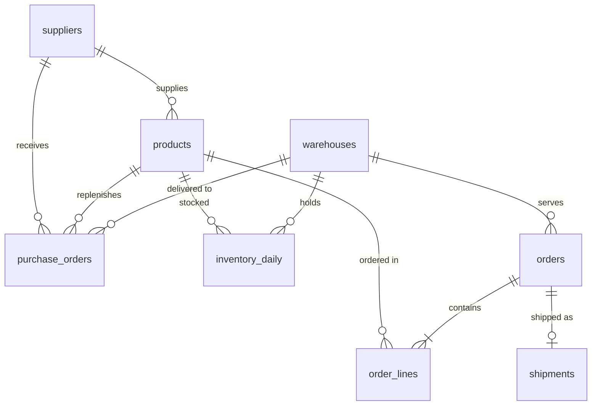

# Supply Chain SQL Analytics

[](https://github.com/insan-sll/supply-chain-sql-analytics/actions/workflows/ci.yml)
[](https://insan-supply-chain-sql.streamlit.app)

Ten questions an operations team actually asks, each answered with one SQL query
on two years of data from a fictional spare-parts distributor: orders, shipments,
purchase orders and daily stock across three warehouses.

**Live demo:** <https://insan-supply-chain-sql.streamlit.app>. Every query with its
chart and result, plus a read-only SQL playground on the same database.

> The data is synthetic. Every supplier, product, carrier and number is invented.
> It is generated by a seeded simulation, so every result here is reproducible.

## What the queries find

| # | Question | Finding |
|---|---|---|
| 1 | [Revenue and gross margin by month](sql/queries/01_revenue_and_margin.sql) | Revenue grew 9.0 % from 2024 to 2025; demand is seasonal while gross margin stays around 32 %. |
| 2 | [On-time delivery by carrier](sql/queries/02_on_time_delivery.sql) | Carrier C keeps the delivery promise on 68 % of shipments, against 96 % for Carrier A. |
| 3 | [ABC analysis](sql/queries/03_abc_analysis.sql) | 47 of 200 products (23.5 %) earn 80 % of revenue. |
| 4 | [Supplier scorecard](sql/queries/04_supplier_scorecard.sql) | S07 delivers 53 % of purchase orders late, by 13 days on average; the next worst is late 19 % of the time. |
| 5 | [Fill rate and lost revenue](sql/queries/05_fill_rate.sql) | 96.1 % fill rate; about €318k of ordered goods could not be shipped, most of it in hydraulics. |
| 6 | [Stockouts on A items](sql/queries/06_stockouts_on_a_items.sql) | 11 of the 15 worst stockout cases on A items are products from S07. |
| 7 | [Inventory turns](sql/queries/07_inventory_turns.sql) | Bearings turn 12 times a year; electronics 8 times, holding about 45 days of demand. |
| 8 | [ABC-XYZ matrix](sql/queries/08_abc_xyz_matrix.sql) | 18 products are both high value and erratic (AZ), carrying 24 % of revenue. |
| 9 | [Order cycle time by warehouse](sql/queries/09_order_cycle_time.sql) | Leipzig is on time for 75 % of orders vs 91 % in Augsburg; the gap is warehouse processing, not transit. |
| 10 | [Do late suppliers cause stockouts?](sql/queries/10_late_suppliers_and_stockouts.sql) | Correlation 0.95 across suppliers, 0.65 without S07. With 12 suppliers this is a strong hint, not proof. |

Full results with tables: [docs/RESULTS.md](docs/RESULTS.md).

The generator builds in a few patterns on purpose (one unreliable supplier, one
weak carrier, one slow warehouse), so the analysis has something real to find. The
queries don't know about them. They find them from the data, and the tests check
that they still do.

## SQL techniques used

- Joins across fact and dimension tables, `GROUP BY ALL`, `HAVING`
- CTEs to break analysis into readable steps
- Window functions: `LAG` for month-over-month and year-over-year growth, running
  `SUM() OVER` for cumulative revenue share, `RANK()`, `corr() OVER ()`
- Ordered-set aggregates: `percentile_cont(0.5) WITHIN GROUP (ORDER BY …)`
- `FILTER (WHERE …)` for conditional aggregates
- A `CROSS JOIN` calendar grid so weeks without demand count as zero
- A reusable view (`product_abc`) shared by several queries
- Primary keys, foreign keys and `CHECK` constraints, so bad data fails on load

## Data model



| Table | Rows | Content |
|---|---|---|
| `suppliers` | 12 | Country and promised lead time |
| `warehouses` | 3 | Augsburg, Hamburg, Leipzig |
| `products` | 200 | Category, supplier, unit cost and price |
| `orders` | ~29,000 | Order date, customer region, serving warehouse |
| `order_lines` | ~67,000 | Ordered and shipped quantity |
| `shipments` | ~28,000 | Carrier, shipped, promised and delivered date |
| `purchase_orders` | ~10,000 | Expected and received date |
| `inventory_daily` | ~436,000 | End-of-day stock per product and warehouse |

## How the data is generated

[`scsql/generate.py`](scsql/generate.py) simulates 2024 and 2025 day by day:

- Customer orders with a fourth-quarter peak, weekday pattern, growth in 2025 and a
  long-tail product mix
- A reorder-point policy per product and warehouse: reorder point = demand over the
  promised lead time + safety stock (z × σ of daily demand × √lead time, z = 2.05)
- Supplier delays drawn per purchase order, and carrier transit times per shipment
- Stock that cannot cover an order is a lost sale, which drives the fill rate

Stock is planned against the promised lead time. That is why a supplier who is
late makes the products it supplies run out, which is what question 10 tests.

## Run it locally

```bash
pip install -r requirements-dev.txt
streamlit run app.py          # the app
pytest -q                     # 35 tests: data integrity, every query, the playground guard, the app pages
python scripts/report.py      # regenerate docs/RESULTS.md
```

To explore in the DuckDB shell:

```python
from scsql.db import build_file

build_file("scsql.duckdb")  # then: duckdb scsql.duckdb
```

## Project layout

```
sql/schema.sql        tables, keys and constraints
sql/views.sql         product_abc view
sql/queries/*.sql     the ten questions (title, question and method in the header)
scsql/generate.py     seeded data simulation
scsql/db.py           builds the DuckDB database
scsql/findings.py     one-sentence findings computed from each result
scsql/playground.py   guard for the free-text SQL box
app.py                Streamlit app
tests/                pytest suite
```

## License

MIT
